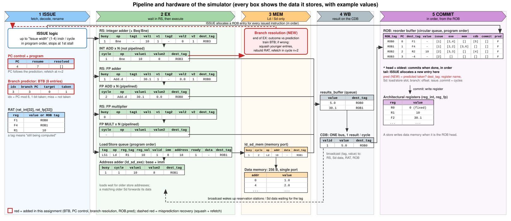

# Report: multi-issue extension of the Python Tomasulo simulator

This report explains (1) the hardware the simulator models, (2) how an instruction moves through it cycle by cycle, (3) what I changed in the original code and why, with the core code, (4) tests and results, and (5) limitations.

The original code was a **single-issue** Tomasulo simulator (one instruction fetched per cycle, no branch prediction). The assignment asks for **in-order multi-issue (width 1–4)**, a **1-bit branch predictor with an 8-entry BTB** and **misprediction recovery**. Everything is done by modifying the files in `code/`.

---

## 1. Hardware modelled

### 1.1 Overview figure

Instructions flow from the top to the bottom: ISSUE, reservation stations, execution units (and memory), the CDB, and finally the ROB, which keeps program order and commits to the registers.



*(Figure source: [hardware.svg](hardware.svg). Red boxes are the parts added in this assignment.)*

How to read it:

* **ISSUE** takes instructions in order, looks up source operands in the **RAT** (either a value, or the tag of the ROB entry that will produce it), creates a **ROB** entry and puts the instruction in a reservation station (RS) or the load/store queue.
* A reservation station holds the instruction until both operands are available (they may arrive from the **CDB**), then it enters a functional unit (**EX**).
* Loads and stores calculate their address in EX, then use **MEM**; a store writes memory only at commit.
* Results go through `results_buffer` onto the **CDB** (one per cycle), which wakes up everything waiting for that tag.
* **COMMIT** retires the oldest instruction in the ROB and writes the architectural register.

### 1.2 What each piece of hardware does, and where it is in the code

| Hardware | Function | Code |
|---|---|---|
| **ISSUE logic** | Takes up to *Issue width* instructions per cycle in program order. Decodes each one, renames its registers through the RAT, allocates a ROB entry and sends it to a reservation station or the load/store queue. Stops at the first instruction that cannot be placed (ROB or RS full). | `issue()`, `issue_one()` in [issue.py](code/issue.py) |
| **PC control** (new) | Holds the next instruction to fetch. Follows the branch prediction, and after a misprediction waits until cycle n+2 before fetching again. | `PC` in [init.py](code/init.py); used in [main.py](code/main.py), [branch.py](code/branch.py) |
| **Branch predictor / BTB** (new) | Predicts at ISSUE whether a branch is taken (1-bit, 8 entries, not-taken on a miss) and is trained when the branch resolves. | `build_btb`, `predict`, `update_btb` in [branch.py](code/branch.py) |
| **RAT** | Tells each new instruction where to get a register: the value, or the tag of the ROB entry that is still computing it. This removes false (WAR/WAW) dependences. | `rat_int`, `rat_fp`, `update_rat()` in [issue.py](code/issue.py) |
| **Reservation stations** (int adder, FP adder, FP multiplier) | Hold an instruction until both source operands are available (captured from the CDB), so execution is out of order. One group of RS per functional-unit type. | `rs_entry`, `build_rs` in [init.py](code/init.py); `put_ins_into_rs()` in [issue.py](code/issue.py) |
| **Functional units** | Execute the operation for the configured number of cycles. Integer adder is not pipelined, FP adder and multiplier are pipelined, and there are *N* of each (`# of FUs`). | `fu_entry` in [init.py](code/init.py); `fu_exe`, `fu_finish`, `fu_fetch_from_rs` in [exe.py](code/exe.py) |
| **Load/Store queue** | Keeps loads and stores in program order, with their address and data. Decides when a load may access memory (all older store addresses known and different) or take the data from an older matching store. | `ld_sd_entry` in [init.py](code/init.py); `put_ins_into_ldsd()` in [issue.py](code/issue.py); `mem()` in [mem.py](code/mem.py) |
| **Address adder** (`ld_sd_exe`) | Computes the effective address `base register + immediate` of a load or store. | `ld_sd_execution()` in [exe.py](code/exe.py) |
| **Memory port** (`ld_sd_mem`) and **data memory** | One non-pipelined access at a time to the 256-byte memory: a load reads, a store writes. | `ld_sd_mem` in [init.py](code/init.py); `mem()` in [mem.py](code/mem.py) |
| **Branch resolution** (new) | When a branch finishes EX it compares the real outcome with the prediction. If wrong, it throws away every younger instruction, rebuilds the RAT and redirects the PC. | `resolve_branches`, `squash`, `rebuild_rat` in [branch.py](code/branch.py) |
| **results_buffer + CDB** | Finished results wait in a queue; the CDB broadcasts one `(tag, value)` per cycle so every waiting instruction can pick up its operand. | `results_buffer`, `cdb`; `wb()`, `boroadcast()` in [wb.py](code/wb.py) |
| **ROB** | Holds every in-flight instruction in program order, with its result and the cycle of every stage. It lets instructions finish out of order but become permanent (commit) in order, and it makes squashing a wrong path simple. | `ROB_entry` in [init.py](code/init.py); `put_ins_into_ROB()` in [issue.py](code/issue.py); `commit()` in [commit.py](code/commit.py) |
| **Architectural registers** | The visible register state R0–R31, F0–F31 (R0 is always 0). Written only at commit, so they never contain wrong-path values. | `reg_int`, `reg_fp`; `modify_arch_reg()` in [commit.py](code/commit.py) |

### 1.3 Data stored in each important structure

A *tag* is the name of a ROB entry (`ROB0`, `ROB1`, …). It is how an instruction says "I am waiting for the result of that instruction". Types are the `namedtuple` definitions in [init.py](code/init.py).

**ROB entry** (`ROB_entry`): one per in-flight instruction, in program order.

| Field | Meaning | Where it is written |
|---|---|---|
| `ROB_tag` | name of the entry, `ROB<n>` with n wrapping at the ROB size; used as the rename tag | `put_ins_into_ROB()` (issue.py) |
| `PC` | index of the instruction in the program | `put_ins_into_ROB()` |
| `dest_tag` | where the result goes: register name (`F1`, `R2`); for `Sd` the load/store-queue slot; for a branch the offset | `put_ins_into_ROB()` |
| `value` | the result; for a branch: taken / not taken | `boroadcast()` (wb.py); `fu_finish()` (exe.py) for branches |
| `issue` | cycle of ISSUE | `put_ins_into_ROB()` |
| `exe` | `[start, end]` cycles of EX | `fu_exe()`, `fu_fetch_from_rs()`, `ld_sd_execution()` (exe.py) |
| `mem` | `[start, end]` cycles of MEM (loads and stores) | `mem()` (mem.py) |
| `cdb` | cycle of the CDB broadcast (non-empty means "result is ready") | `boroadcast()` (wb.py) |
| `commit` | cycle of commit | `commit()` (commit.py), `mem()` for stores |
| `pred` | **new**: branch prediction made at issue (True = taken) | `put_ins_into_ROB()` (init False), `issue_one()` (issue.py) |

**RAT** (`rat_int[32]`, `rat_fp[32]`): one slot per register. The slot holds either the *value* (register is up to date) or the tag `ROBn` of the youngest in-flight instruction that will write it. Set up in [main.py](code/main.py), renamed in `update_rat()` ([issue.py](code/issue.py)), replaced by the value in `boroadcast()` ([wb.py](code/wb.py)), rebuilt after a misprediction by `rebuild_rat()` ([branch.py](code/branch.py)).

**Reservation station entry** (`rs_entry`):

| Field | Meaning | Where it is written |
|---|---|---|
| `busy` | slot in use | `put_ins_into_rs()` sets 1; `fu_fetch_from_rs()` and `squash()` clear it |
| `op` | operation (`Add`, `Add.d`, `Mult.d`, `Bne`, …) | `put_ins_into_rs()` |
| `tag_1st`, `value_1st`, `valid_1st` | first operand: the tag it waits for, its value, and whether the value is available | `put_ins_into_rs()` (from the RAT); `boroadcast()` fills the value |
| `tag_2nd`, `value_2nd`, `valid_2nd` | the same for the second operand | same as above |
| `dest_tag` | ROB tag of this instruction (where the result is sent) | `put_ins_into_rs()` |

The instruction may start execution when `valid_1st` and `valid_2nd` are both 1 (checked in `fu_fetch_from_rs()`).

**Functional unit entry** (`fu_entry`):

| Field | Meaning |
|---|---|
| `op` | operation being executed |
| `value1`, `value2` | the two operand values (copied from the RS by `add_entry_into_fu()` in exe.py) |
| `dest_tag` | ROB tag of the instruction |
| `cycle` | cycles already spent in EX; the operation finishes when it equals `Cycles in EX` (`fu_exe()`) |

**Load/store queue entry** (`ld_sd_entry`), in program order:

| Field | Meaning | Where it is written |
|---|---|---|
| `ld_sd_tag` | slot name in the queue | `put_ins_into_ldsd()` (issue.py) |
| `op` | `Ld` or `Sd` | `put_ins_into_ldsd()` |
| `reg_tag`, `reg_value`, `valid` | the base register of `imm(Rn)` and whether its value is ready | `put_ins_into_ldsd()`; `boroadcast()` fills the value |
| `immediate` | the offset | `put_ins_into_ldsd()` |
| `address`, `ready` | effective address and whether it has been calculated | `ld_sd_execution()` (exe.py) |
| `data` | for `Sd`: the value to store (or the tag it still waits for) | `put_ins_into_ldsd()`; `boroadcast()` |
| `dest_tag` | ROB tag of this instruction | `put_ins_into_ldsd()` |

A load goes to memory when its address is ready and every older store has a known, different address (`check_all_previous_Sd_no_match()`), or it takes the data from the nearest older store with the same address (`forward_check_from_sd()`), both in [mem.py](code/mem.py).

**Other structures**

| Structure | Fields | Meaning / code |
|---|---|---|
| `ld_sd_exe` (address adder) | `busy`, `cycle`, `value1`, `value2`, `dest_tag` | the one address calculation in progress; `ld_sd_execution()` in exe.py |
| `ld_sd_mem` (memory port) | `busy`, `cycle`, `op`, `address`, `data`, `dest_tag` | the one memory access in progress; `mem()` in mem.py |
| `results_buffer` | queue of `fu_result` = (`value`, `dest_tag`) | finished results waiting for the CDB; `fu_finish()`, `mem()` append, `wb()` removes |
| `cdb` | `valid`, `value`, `dest_tag` | the result being broadcast this cycle; `wb()` in wb.py |
| `PC` | `PC`, `valid`, `resume`, `resolved` | `PC` = next instruction; **new**: `resume` = first cycle fetch is allowed, `resolved` = branches that finished EX this cycle |
| `btb[8]` | **new**: `(branch PC, target PC, taken bit)` or empty | index = `PC mod 8`; `predict()`, `update_btb()` in branch.py |
| `memory[256]` | one slot per byte address (the handbook's 256 B; words sit at multiples of 4) | read/written in `mem()`; non-zero values are printed at the end |

Example: right after `Add.d F1,F2,F3` is issued in cycle 1 as the first instruction, the structures contain:

```
ROB[0]  = {ROB_tag: ROB0, PC: 0, dest_tag: F1, value: -, issue: [1], exe: [], mem: [], cdb: [], commit: [], pred: False}
RAT_fp[1] = "ROB0"                                    # F1 is now being produced by ROB0
RS_fpadder[0] = {busy: 1, op: Add.d, tag_1st: -, value_1st: 30.1, valid_1st: 1,
                 tag_2nd: -, value_2nd: 0.0, valid_2nd: 1, dest_tag: ROB0}
```

---

## 2. How an instruction moves through the cycles

Stages: **ISSUE → EX → MEM (loads/stores only) → WB (CDB broadcast) → COMMIT**.

The main loop in [main.py](code/main.py) runs these steps once per cycle:

```python
while len(ROB)>0 or 0<=PC.PC<len(instructions) or ld_sd_mem.busy==1:
    if 0<=PC.PC<len(instructions) and cycle>=PC.resume:
        issue(...)              # up to issue_width instructions, in order
    exe(...)                    # run FUs, start new ops from RS, address calc for Ld/Sd
    resolve_branches(...)       # NEW: handle branches that finished EX, recover if wrong
    mem(...)                    # forwarding / memory access
    wb(...)                     # one result on the CDB, wake up waiting instructions
    commit(...)                 # retire the ROB head
    cycle += 1
```

### 2.1 Example: the handbook program at width 1 and width 2

Program (`tests/t1_spec_sample.in`; FP adder 3 cycles, load EX 1 + MEM 4, `R2=20`, `R3=0`):

```
Add.d F1, F2, F3
Ld    F4, 8(R1)
Addi  R2, R2, -10
Bne   R2, R3, -4        # loop back to the first instruction
```

Width 1 (original behaviour), each row shows the cycle numbers of the stages:

```
                              ISSUE   EXE      MEM      WB     COMMIT
Add.d F1 F2 F3                [1]     [2, 4]   []       [6]    [7]
Ld F4 8(R1)                   [2]     [3, 3]   [4, 7]   [8]    [9]
Addi R2 R2 -10                [3]     [4, 4]   []       [5]    [10]
Bne R2 R3 -4                  [4]     [6, 6]   []       []     [11]      <- predicted not-taken, really taken
Add.d F1 F2 F3                [8]     [9, 11]  []       [13]   [14]      <- refetched after the misprediction
...
```

Width 2: two instructions enter the machine in the same cycle:

```
                              ISSUE   EXE      MEM      WB     COMMIT
Add.d F1 F2 F3                [1]     [2, 4]   []       [5]    [6]
Ld F4 8(R1)                   [1]     [2, 2]   [3, 6]   [7]    [8]
Addi R2 R2 -10                [2]     [3, 3]   []       [4]    [9]
Bne R2 R3 -4                  [2]     [5, 5]   []       []     [10]
Add.d F1 F2 F3                [7]     [8, 10]  []       [11]   [12]      <- second iteration
...
```

What happens, cycle by cycle (width 2):

| Cycle | What the hardware does |
|---|---|
| 1 | `Add.d` and `Ld` are issued together (renamed: F1→ROB0, F4→ROB1; put into RS / ld-sd queue). |
| 2 | `Addi` and `Bne` are issued. `Bne` is looked up in the BTB: miss → predict **not taken**, fetch continues at the next PC. `Add.d` and `Ld` start EX. |
| 3 | `Addi` is in EX. `Ld` has its address and (no older store) starts MEM. |
| 4 | `Addi` finishes EX; its result goes through the CDB. `Add.d` finishes EX (3 cycles). |
| 5 | `Add.d` broadcasts on the CDB (one result per cycle). `Bne` runs EX; it is **resolved: taken**, prediction was wrong. |
| 5 (end) | `resolve_branches`: BTB updated; everything younger than `Bne` is squashed; RAT is rebuilt; `PC` set to the target; fetch resumes at cycle 5+2 = **7**. |
| 6–10 | Commit in order: `Add.d`(6), `Ld`(8), `Addi`(9), `Bne`(10). |
| 7 | The second iteration is issued from the loop start. Its `Bne` now hits the BTB (taken bit set), so it is predicted taken. |

---

## 3. What I changed in the code, and why

Summary of files: `init.py` (input), `issue.py` (multi-issue + branches), `branch.py` (**new**), `exe.py`, `mem.py`, `wb.py`, `commit.py`, `main.py`.

### 3.1 Multi-issue — `issue.py`

The original `issue()` issued one instruction. I renamed it `issue_one()` (it now returns 0 = not issued, 1 = issued, 2 = branch predicted taken) and wrote a new `issue()` that calls it up to *issue width* times:

```python
def issue(cycle, PC, instructions, ROB, size_ROB, rs_int_adder, rs_fp_adder, rs_fp_multi,
          ld_sd_queue, size_ld_sd_queue, rat_int, rat_fp, btb, issue_width):
    for _ in range(issue_width):
        if not (0 <= PC.PC < len(instructions)):
            break
        result = issue_one(cycle, PC, instructions, ROB, size_ROB, ...)
        if result != 1:      # stalled (ROB / RS / queue full) or predicted-taken branch
            break
```

Because the loop stops at the first instruction that cannot be issued, issue stays **in order**. After a predicted-taken branch the group ends, since the next instruction is on a different path. Each instruction renames against the RAT *after* the previous one in the same group updated it, so two dependent instructions in one group get the right tags.

### 3.2 Branch prediction at issue — `issue.py` / `branch.py` (new)

`Beq` was missing and `Bne` used to simply stall fetch. Now a branch is predicted when it is issued:

```python
# issue_one(), Beq/Bne case
taken, next_PC = predict(btb, PC.PC)
ROB[-1].pred = taken          # remember the prediction in the ROB entry
PC.PC = next_PC               # keep fetching along the predicted path
return 2 if taken else 1
```

The predictor in `branch.py`: 8 entries, index = `pc % 8`; an entry is `(branch pc, target pc, taken bit)`. A miss predicts not-taken.

```python
def predict(btb, pc):
    entry = btb[pc % BTB_SIZE]
    if entry is not None and entry[0] == pc and entry[2]:
        return True, entry[1]
    return False, pc + 1

def update_btb(btb, pc, target, taken):
    btb[pc % BTB_SIZE] = (pc, target, taken)     # 1-bit: just remember the last outcome
```

Per the handbook, `Beq/Bne Rs, Rt, offset` has target `PC + 1 + offset` in **instructions** (the original code used byte offsets such as `-12`; these were changed).

### 3.3 Branch resolution and recovery — `exe.py` / `branch.py`

A branch executes in the integer adder. When it finishes EX, `fu_finish` computes the outcome and queues it instead of producing a register result:

```python
if (element.op=='Bne')|(element.op=='Beq'):
    if element.op == 'Bne':
        ROB[index].value = (element.value1 != element.value2)
    else:
        ROB[index].value = (element.value1 == element.value2)
    PC.resolved.append(element.dest_tag)     # handled by resolve_branches() this cycle
```

`resolve_branches` (called right after `exe` in `main.py`) trains the BTB and, on a wrong prediction, recovers:

```python
target = entry.PC + 1 + entry.dest_tag
update_btb(btb, entry.PC, target, taken)
if taken != entry.pred:
    squash(index, ROB, rs_list, fu_list, results_buffer, cdb, ld_sd_queue, ld_sd_exe, ld_sd_mem)
    rebuild_rat(ROB, rat_int, rat_fp, reg_int, reg_fp)
    PC.PC = target if taken else entry.PC + 1
    PC.resume = cycle + 2                    # detected in cycle n -> fetch again in n+2
```

* `squash` removes every entry younger than the branch from the ROB, the reservation stations (which also clears their wait tags), functional units, `results_buffer`, the CDB, the load/store queue and an in-flight wrong-path **load**.
* `rebuild_rat` restores the RAT from the architectural registers and the ROB entries that survived. Without this, later instructions would wait on tags that no longer exist.

### 3.4 Several functional units and an unpipelined integer adder — `exe.py`

The unit table gives `# of FUs`. `fu_fetch_from_rs` moves ready instructions from a reservation station into the unit, at most `nfu` per cycle; for the unpipelined integer adder a new operation can only start when the unit is free:

```python
if (not pipelined) and (len(fu) + finished >= nfu):
    break
```

### 3.5 Bug fixes in the original code (needed for multi-issue to be correct)

| File | Bug | Fix |
|---|---|---|
| `exe.py` | `fu_exe` advanced operations that were already in flight twice per cycle | each operation advances once per cycle |
| `exe.py` | `ld_sd_execution` counted only the first EX cycle, so an EX time above 1 never finished | the counter advances every cycle (`else: ld_sd_exe.cycle += 1`) |
| `mem.py` | `check_if_sd_committable` was called without parentheses (never evaluated) and had a typo | rewritten: a store may write memory only when it is the ROB head |
| `wb.py` | a CDB broadcast overwrote the RAT even when a younger instruction had renamed the same register (WAW) | update the RAT only if it still holds this instruction's tag (`if rat_int[...] == dest_tag`) |
| `issue.py` | `Ld`/`Sd` registers with two digits (`F12`) were parsed wrongly | regex parse |
| `commit.py` | branches had no commit path; R0 could be written | branches commit once resolved; R0 is skipped |

### 3.6 Input and output — `init.py`, `main.py`

`init.py` has a new `read_input()` that parses the handbook input format (unit table, `ROB entries`, `Issue width` 1–4 default 1, `R1=…`, `F2=…`, `Mem[..]=…` and the program). `main.py` prints the stage table, all register values and non-zero memory, as the handbook asks.

### 3.7 Unchanged on purpose

One CDB, one commit per cycle (original commit logic), load/store disambiguation and forwarding. The handbook does not ask to change these.

---

## 4. Tests

`python3 run_tests.py` runs every `tests/*.in` at issue widths 1–4 and compares the committed instruction stream, final registers and memory with a sequential reference interpreter. It also checks: at most *width* issues per cycle, at most one WB per cycle, correct stage ordering, in-order issue and commit.

| Test | What it covers |
|---|---|
| t1_spec_sample | The handbook example, edited so that it terminates |
| t2_independent_alu | Independent ops: benefit of wide issue |
| t3_dependency_chain | RAW chain: little benefit from width |
| t4_load_store_forwarding | Store-to-load forwarding and memory disambiguation |
| t5_branch_loop | Predictor learning a loop |
| t6_branch_not_taken_skip | Misprediction recovery |
| t7_structural_hazards | Few RS/FUs |
| t8_mixed_nested_loop | Everything together |

All 32 runs (8 tests × 4 widths) pass. In addition, 380 randomly generated programs (random unit sizes, ROB sizes, forward branches and a loop) were checked against the reference at all four widths with no mismatch.

## 5. Results

| Test | W1 cycles | W2 | W3 | W4 | last issue cycle (W1/W2/W3/W4) |
|---|---|---|---|---|---|
| t1 | 18 | 16 | 15 | 15 | 11 / 8 / 7 / 6 |
| t2 | 18 | 18 | 18 | 18 | 12 / 6 / 4 / 3 |
| t3 | 30 | 28 | 27 | 27 | 9 / 5 / 3 / 3 |
| t4 | 22 | 22 | 22 | 22 | 10 / 8 / 8 / 8 |
| t5 | 40 | 39 | 38 | 38 | 29 / 21 / 20 / 20 |
| t6 | 18 | 15 | 15 | 15 | 12 / 9 / 8 / 8 |
| t7 | 41 | 41 | 41 | 41 | 29 at all widths |
| t8 | 72 | 63 | 60 | 60 | 64 / 47 / 42 / 44 |

Wider issue clearly shortens the time to issue the program (last-issue column). Total cycles improve less, and sometimes not at all (t2, t4, t7), because the machine keeps the handbook's single CDB and about one commit per cycle, so completion is commit-bound. Programs with branches (t1, t6, t8) gain more, since a wider front end refills faster after a misprediction. In t8, width 4 issues its last instruction slightly later than width 3 (44 vs 42) because more wrong-path work is issued and squashed.

## 6. Limitations and interpretations

* The handbook sample would not terminate, so t1 was edited (`Addi R2,R2,-10`, branch offset) to end.
* The original code used byte branch offsets; they are now instruction counts per the handbook (`PC + 1 + offset`).
* A store writes memory only when it is at the ROB head.
* There is one load/store unit, and only one branch recovery is handled per cycle.
* The report is Markdown, not PDF.
